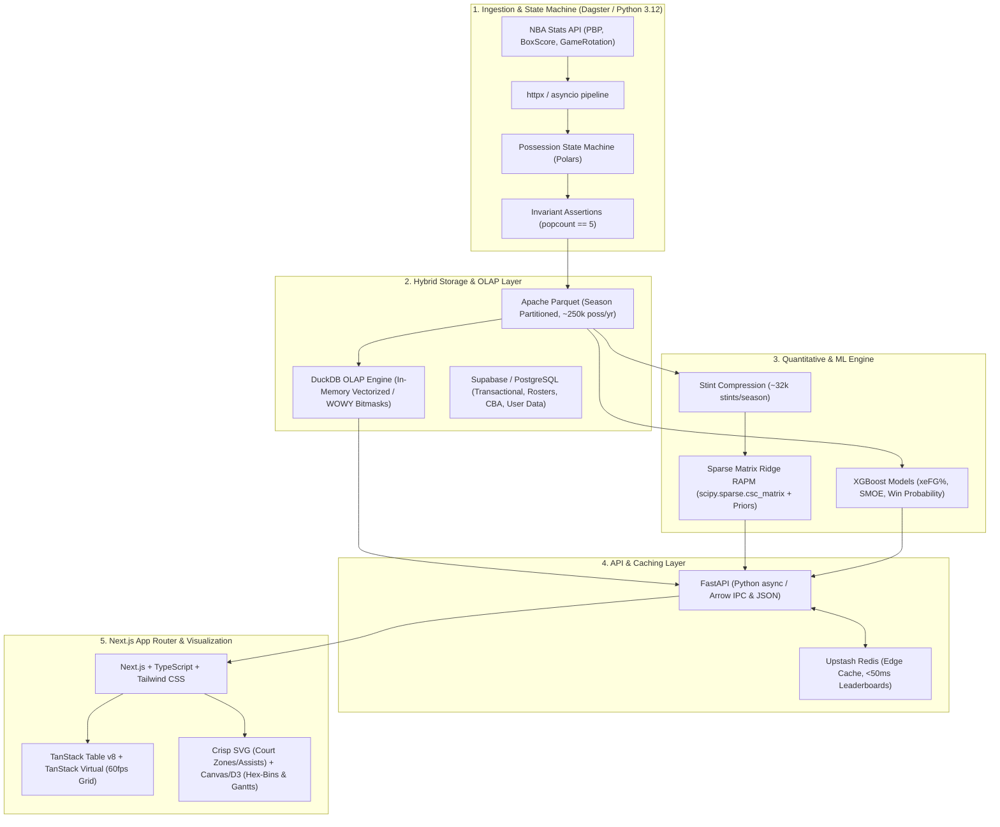

# NBA Analytics Platform - System Architecture & Technical Specification

> **Version**: 2.3.0-PROD  
> **Status**: Phase 1, Phase 2, and Phase 3 Implemented & Fully Verified  
> **Target System**: Antigravity NBA Analytics Platform

---

## 1. System Overview & Architectural Topology

The platform transitions from a monolithic SQLite/Flask prototype into a decoupled, high-performance analytical pipeline and OLAP architecture designed for sub-second quantitative basketball analytics, micro-level possession tracking, and interactive exploration.



---

## 2. In-Depth Component Specifications

### 2.1. Data Ingestion & State Parsing
* **Runtime**: Python 3.12 with `httpx` (HTTP/2, async connection pooling) and `Polars` for fast multi-threaded DataFrame transformations.
* **Orchestration**: Dagster pipeline running daily at **4:00 AM PT** (following complete West Coast game finalization and official stat auditing), with GitHub Actions cron fallback.
* **Possession State Machine (PSM)**:
  * Ingests official NBA Play-by-Play (v3), Traditional & Advanced Box Scores, and `GameRotation` endpoints.
  * **Quarter-Starting 5 Forward Scanner**: Solves the classic raw PBP bug where players who start a period without recording an event before the first substitution are omitted. Scans backward from substitutions and forward from period boundaries to ensure exact 5-man tracking.
  * **Invariant Assertion**:
    $$\text{popcount}(\text{off\_mask}) == 5 \quad \land \quad \text{popcount}(\text{def\_mask}) == 5$$
    Any possession event failing the 5-on-5 popcount assertion is flagged and quarantined for automated reconciliation against GameRotation stint logs.

---

### 2.2. Storage & OLAP Engine
* **Analytical Engine**: **DuckDB** querying Parquet files directly via memory-mapped zero-copy operations.
* **File Structure**:
  ```
  data/
  ├── gold/
  │   └── possessions/
  │       ├── season=2022-23/
  │       │   └── part-0.parquet (~250,000 rows)
  │       ├── season=2023-24/
  │       │   └── part-0.parquet
  │       └── season=2024-25/
  │           └── part-0.parquet
  ```
* **Relational / Transactional Store**: **Supabase (PostgreSQL 16)** storing player biographical data, contract structures, CBA Apron rules (Tax Apron 1, Tax Apron 2, trade exceptions, cap holds), user portfolios, and user preference state.
* **Vectorized WOWY (With-Or-Without-You) Indexing**:
  * Every possession record stores:
    1. Fixed integer arrays: `off_players INT[5]`, `def_players INT[5]`
    2. Team-Season Bitmasks: `off_mask UINT64`, `def_mask UINT64`
  * Mapping: Each player on a team-season roster is mapped to a bit index $i \in [0, 31]$.
  * **Sub-15ms WOWY Filter**:
    $$\text{Match} = (\text{off\_mask} \ \& \ M_{\text{on}} == M_{\text{on}}) \ \land \ (\text{off\_mask} \ \& \ M_{\text{off}} == 0)$$
    Executed via native DuckDB bitwise operators across all 250k rows in under 15ms.

---

### 2.3. Quantitative & ML Modeling Backend
* **Regularized Adjusted Plus-Minus (RAPM)**:
  * **Stint Compression**: Compresses ~250k possession events into ~32,000 distinct stint intervals where no player substitutions occurred.
  * **Sparse Formulation**:
    $$y = X \beta + \epsilon$$
    where $X \in \mathbb{R}^{S \times 2P}$ (stints $\times$ players, $+1$ for offense, $-1$ for defense), weighted by diagonal stint weight matrix $W$ (possession count or stint length).
  * **Bayesian Ridge Regression with Box/Tracking Priors**:
    $$\hat{\beta} = (X^T W X + \lambda I)^{-1} (X^T W y + \lambda \beta_{\text{prior}})$$
    Constructed and solved using `scipy.sparse.csc_matrix` and sparse Cholesky / LSQR solvers, converging in $\le 1.5\text{ seconds}$ per season.
* **Spatial & Probabilistic Models (XGBoost)**:
  * **Expected Effective Field Goal % ($x\text{eFG}\%$)**: Evaluates shot quality using shot distance, angle, nearest defender distance, shot clock time remaining, touch time, and dribble count.
  * **Shot-Making Over Expected (SMOE)**:
    $$\text{SMOE} = \text{eFG}\% - x\text{eFG}\%$$
  * **Real-time Win Probability**: Gradient-boosted probability estimator calibrated with score differential, possession arrow, seconds remaining, bonus/foul count, and pre-game spread prior.

---

### 2.4. API & Caching Layer
* **Framework**: **FastAPI** (Python 3.12 async) supporting high-concurrency event loops.
* **Data Payloads**: Dual serialization: standard JSON for REST endpoints; Apache Arrow IPC streaming for massive multi-season stint and possession matrix payloads.
* **Caching Tier**: **Upstash Redis**:
  * Pre-computed daily percentile leaderboards (0–100 percentile rank across all qualified players).
  * Default team/player profile cards edge-cached with a 24-hour TTL, revalidated on daily ingestion completion to maintain **sub-50ms p95 response times**.

---

### 2.5. Frontend UI & Visualization Stack
* **Framework**: **Next.js 15 (App Router)** + **TypeScript** + **Tailwind CSS**.
* **High-Throughput Data Grids**: **TanStack Table v8** integrated with **TanStack Virtual**, rendering 500+ active players with zero frame drop (stable 60fps) with dynamic percentile heat badges.
* **Visualization Layer**:
  * **SVG**: Court zones, assist network node-graphs, and responsive shooting arcs.
  * **HTML5 Canvas / D3.js**: High-density hex-bin shot charts (rendering 50k+ shot coordinates smoothly) and Player Rotation Timeline / Stint Gantt charts.
