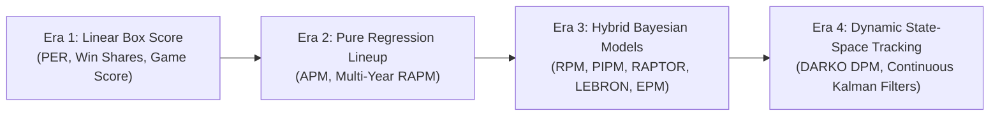
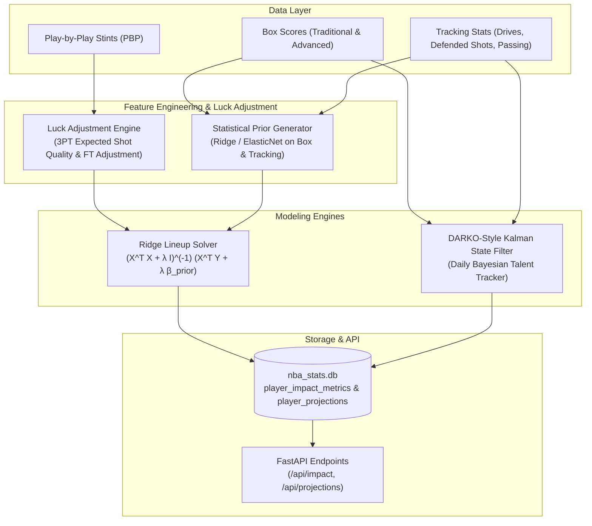

# Comprehensive Research Report: Advanced NBA Predictive & Impact Statistics

> **Author**: Antigravity Analytics Research  
> **Date**: September 2026  
> **Target Scope**: Modern NBA Impact Metrics, Predictive Modeling, FiveThirtyEight's CARMELO & RAPTOR, BBall Index's LEBRON, Dunks & Threes' EPM, DARKO DPM, and Implementation Strategies for `nba-stats-db`.

---

## Table of Contents
1. [Executive Summary & Paradigm Overview](#1-executive-summary--paradigm-overview)
2. [Foundational Mathematics of Basketball Impact](#2-foundational-mathematics-of-basketball-impact)
   - [The Unit of Measurement: Points Per 100 Possessions](#the-unit-of-measurement-points-per-100-possessions)
   - [The Collinearity Crisis & The Birth of RAPM](#the-collinearity-crisis--the-birth-of-rapm)
   - [The Bayesian Solution: Statistical Priors](#the-bayesian-solution-statistical-priors)
   - [Luck Adjustment: Filtering Random Noise](#luck-adjustment-filtering-random-noise)
3. [FiveThirtyEight's Predictive Systems](#3-fivethirtyeights-predictive-systems)
   - [CARMELO: Career-Arc Regression Model Estimator with Local Optimization](#carmelo-career-arc-regression-model-estimator-with-local-optimization)
   - [RAPTOR: Robust Algorithm using Player Tracking and On/Off Ratings](#raptor-robust-algorithm-using-player-tracking-and-onoff-ratings)
4. [BBall Index's LEBRON Model](#4-bball-indexs-lebron-model)
   - [Philosophy & Architecture](#philosophy--architecture)
   - [Luck-Adjusted RAPM (LA-RAPM) Integration](#luck-adjusted-rapm-la-rapm-integration)
   - [Offensive Archetypes & Role Context](#offensive-archetypes--role-context)
5. [The Modern Frontier Models](#5-the-modern-frontier-models)
   - [EPM (Estimated Plus-Minus) by Taylor Snarr](#epm-estimated-plus-minus-by-taylor-snarr)
   - [DARKO / DPM (Daily Adjusted and Regressed Kalman Optimized) by Kostya Medvedovsky](#darko--dpm-daily-adjusted-and-regressed-kalman-optimized-by-kostya-medvedovsky)
6. [Other Seminal & Historical Models](#6-other-seminal--historical-models)
   - [PIPM (Player Impact Plus-Minus) by Jacob Goldstein](#pipm-player-impact-plus-minus-by-jacob-goldstein)
   - [ESPN's RPM (Real Plus-Minus) by Jeremias Engelmann](#espns-rpm-real-plus-minus-by-jeremias-engelmann)
   - [BPM 2.0 & VORP (Basketball-Reference) by Daniel Myers](#bpm-20--vorp-basketball-reference-by-daniel-myers)
7. [Comprehensive Comparative Matrix](#7-comprehensive-comparative-matrix)
8. [Engineering & Implementation Roadmap for `nba-stats-db`](#8-engineering--implementation-roadmap-for-nba-stats-db)

---

## 1. Executive Summary & Paradigm Overview

Basketball analytics has evolved through four distinct eras:



1. **Era 1 (Linear Box-Score Aggregations)**: 1980s–2000s. Metrics like John Hollinger's **PER** (Player Efficiency Rating) and Bill James-inspired **Win Shares** assigned fixed weights to traditional counting statistics. While intuitive, they suffered from major collinearity issues, overvalued volume scoring/rebounding, and were virtually blind to defensive impact beyond steals and blocks.
2. **Era 2 (Pure Lineup Regressions)**: Mid-2000s–2010s. Wayne Winston and Jeff Sagarin pioneered **Adjusted Plus-Minus (APM)**, isolating player value on 5-man lineup score differentials. Dan Rosenbaum and Joe Sill introduced **Regularized Adjusted Plus-Minus (RAPM)** via Ridge Regression ($L_2$ regularization) to overcome extreme multicollinearity. Pure RAPM was unbiased but suffered from massive variance, requiring 3 to 5 seasons of sample size (~10,000+ possessions) to stabilize.
3. **Era 3 (Hybrid Bayesian Impact Models)**: 2014–2020. Recognizing that pure on/off data is too noisy for single-season evaluation and pure box-score data misses off-ball impact, analysts engineered **Bayesian Hybrid Models** (**RPM**, **PIPM**, **RAPTOR**, **LEBRON**, **EPM**). These models construct a rich statistical "prior" (using player tracking data, micro-stats, and box-score regression) and use it to regularize the lineup stint regression.
4. **Era 4 (Dynamic State-Space & Machine Learning Models)**: 2020–Present. Led by **DARKO (DPM)**, modern analytics shifted from retrospective single-season summaries to **continuous daily predictive tracking** using Kalman Filters and exponential decay curves, capturing aging, injury recovery, and true talent trajectory in real time.

---

## 2. Foundational Mathematics of Basketball Impact

### The Unit of Measurement: Points Per 100 Possessions
All modern all-in-one impact metrics express player value in **net points contributed per 100 possessions ($\Delta$ Net Rating)** relative to league average ($0.0$).

$$\text{Impact Metric} = \text{Offensive Impact} + \text{Defensive Impact}$$

- $+5.0$: MVP candidate (Top ~5 player in NBA)
- $+3.0$: All-Star caliber
- $+1.5$: High-end starter
- $0.0$: League-average rotation player
- $-2.0$: Replacement level
- $-4.0$ or lower: Sub-replacement / G-League callup level

### The Collinearity Crisis & The Birth of RAPM
In raw on/off data, players who share the floor frequently (e.g., Stephen Curry and Draymond Green) are mathematically entangled. 

In standard Adjusted Plus-Minus (APM), each possession stint $i$ is modeled as a linear equation:

$$y_i = \beta_0 + \sum_{j=1}^{P} X_{ij} \beta_j + \epsilon_i$$

Where:
- $y_i$ is the margin of victory per 100 possessions during stint $i$.
- $X_{ij} = 1$ if player $j$ is on offense/home, $-1$ if on defense/away, and $0$ if on the bench.
- $\beta_j$ is player $j$'s true impact.

Because $X^T X$ is ill-conditioned (near-singular due to collinear lineups), ordinary least squares (OLS) yields massive standard errors.

#### Ridge Regression (RAPM)
To stabilize the coefficients, Joe Sill (2010) applied **Ridge Regression ($L_2$ Regularization)**:

$$\hat{\beta}_{\text{RAPM}} = \arg\min_{\beta} \left( \| Y - X\beta \|_2^2 + \lambda \|\beta\|_2^2 \right) = (X^T X + \lambda I)^{-1} X^T Y$$

The penalty parameter $\lambda$ shrinks player coefficients toward zero (league average), reducing variance at the cost of slight bias.

### The Bayesian Solution: Statistical Priors
Standard RAPM shrinks all players toward $0.0$. However, shrinking a prime LeBron James or Nikola Jokić toward zero ignores overwhelming evidence that they are superstar-level contributors.

**Informed-Prior RAPM (Hybrid RAPM)** modifies the objective function:

$$\hat{\beta}_{\text{Hybrid}} = \arg\min_{\beta} \left( \| Y - X\beta \|_2^2 + \lambda \|\beta - \beta_{\text{prior}}\|_2^2 \right)$$

$$\hat{\beta}_{\text{Hybrid}} = (X^T X + \lambda I)^{-1} (X^T Y + \lambda \beta_{\text{prior}})$$

Where $\beta_{\text{prior}}$ is computed from individual tracking stats, box scores, shot quality, and spatial metrics.

```
┌─────────────────────────────────────────────────────────────┐
│                      HYBRID METRIC                          │
│                                                             │
│   ┌───────────────────────┐     ┌───────────────────────┐   │
│   │   Statistical Prior   │  +  │    Lineup Stints      │   │
│   │ (Box / Tracking / QC) │     │ (Play-by-Play RAPM)   │   │
│   └───────────┬───────────┘     └───────────┬───────────┘   │
│               │                             │               │
│               └──────────────► ◄────────────┘               │
│                               │                             │
│                     Bayesian Ridge Blending                 │
│                               │                             │
│                               ▼                             │
│                    Final Player Rating                      │
│                 (Points / 100 Possessions)                  │
└─────────────────────────────────────────────────────────────┘
```

### Luck Adjustment: Filtering Random Noise
A critical breakthrough popularized by Jacob Goldstein (PIPM) and Krishna Narsu (LEBRON) was **Luck Adjustment**:

1. **3-Point Defense Variance**: Extensive research confirms NBA teams have very little control over an opponent's open 3-point shooting percentage; they primarily control **3-point attempt frequency**. A player whose opponents shoot $28\%$ on wide-open threes is benefiting from defensive "luck." Luck-adjusted models replace actual opponent 3P% with the shooter's expected 3P% based on shooter skill and contest proximity.
2. **Opponent Free Throw Shooting**: Defenders have zero control over opponent free-throw shooting percentage. Luck-adjusted stint data replaces opponent FT points with expected points given the foul shooter's career/season FT%.

---

## 3. FiveThirtyEight's Predictive Systems

FiveThirtyEight was a dominant public force in basketball analytics, producing two landmark systems: **CARMELO** (long-term career forecasting) and **RAPTOR** (granular in-season impact and tracking fusion).

---

### CARMELO: Career-Arc Regression Model Estimator with Local Optimization

```
  CARMELO Workflow
  ┌─────────────────────────┐
  │ Target Player           │ (Age, Height, Weight, Draft Pos, Box Stats, Advanced Metrics)
  └───────────┬─────────────┘
              │  k-Nearest Neighbors (k-NN) Similarity Distance
              ▼
  ┌─────────────────────────┐
  │ Top Historical Comps    │ (e.g. 10 most similar historical careers at same age)
  └───────────┬─────────────┘
              │  Weighted Career Arc Projection + Bayesian Aging Curves
              ▼
  ┌─────────────────────────┐
  │ 5-Year Forecast & Tier  │ (Future WAR, 5-Yr Market Value $, Category: "Future MVP", etc.)
  └─────────────────────────┘
```

#### 1. Background & Etymology
Developed in 2014–2015 by Nate Silver and Neil Paine, **CARMELO** was inspired by Silver's famous baseball projection system, **PECOTA**. It was named after Carmelo Anthony following an analysis of his long-term contract value and later converted into the backronym:  
*Career-Arc Regression Model Estimator with Local Optimization*.

#### 2. Core Methodology
CARMELO operated on a **$k$-Nearest Neighbors ($k$-NN) similarity algorithm**:
- **Player Feature Space**: Height, weight, draft position, usage rate, true shooting percentage, rebound/assist/steal/block rates, turnover rate, foul rate, pace, and Box Plus-Minus (BPM) / Real Plus-Minus (RPM).
- **Historical Database**: Every player season from the 1976–77 merger onward.
- **Comparable Identification**: For a given player at age $A$, the system measured multidimensional Euclidean distance against all historical players at age $A$.
- **Trajectory Modeling**: The model extracted the subsequent 5–7 seasons of the identified historical comparables to build a probabilistic distribution of potential future career arcs.

#### 3. Output Dimensions
- **Projected WAR (Wins Above Replacement)**: Cumulative projected value over a 5-year window.
- **5-Year Market Value (\$ Millions)**: Converting projected WAR into economic value based on projected salary cap and cost-per-win estimates.
- **Player Archetype / Category Classifications**:
  - *All-Star / MVP Candidate*
  - *Up-and-Comer*
  - *Key Role Player / Solid Starter*
  - *Rotation Piece*
  - *Project / Scrub / Way Past Prime*

#### 4. Limitations & Evolution
CARMELO relied heavily on box-score metrics and basic positional traits, making it vulnerable to system shifts, changing modern 3-point spacing, and players whose archetype had no historical precedent (e.g., Nikola Jokić, Draymond Green). It was officially superseded in 2019 by **RAPTOR**.

---

### RAPTOR: Robust Algorithm using Player Tracking and On/Off Ratings

```
  RAPTOR Architecture
  ┌────────────────────────────────────────────────────────┐
  │                  Data Input Streams                    │
  ├───────────────────┬───────────────────┬────────────────┤
  │ Traditional Box   │ Second Spectrum   │ Play-by-Play   │
  │ Statistics        │ Tracking & Matchup│ Lineup Stints  │
  └─────────┬─────────┴─────────┬─────────┴────────┬───────┘
            │                   │                  │
            ▼                   ▼                  │
  ┌───────────────────────────────────────┐        │
  │        Box / Tracking RAPTOR          │        │
  │   (Machine Learning Metric Prior)     │        │
  └───────────────────┬───────────────────┘        │
                      │                            ▼
                      │                 ┌──────────────────────┐
                      │                 │    On/Off RAPTOR     │
                      │                 │ (Ridge Regularized)  │
                      │                 └──────────┬───────────┘
                      │                            │
                      ▼                            ▼
            ┌─────────────────────────────────────────────┐
            │         Bayesian Hybrid RAPTOR              │
            │  (O-RAPTOR, D-RAPTOR, Total RAPTOR, WAR)    │
            └─────────────────────────────────────────────┘
```

#### 1. Background & Scope
Introduced before the 2019–20 season, **RAPTOR** (*Robust Algorithm using Player Tracking and On/Off Ratings*) was FiveThirtyEight’s flagship NBA evaluation and projection metric until the sports division's closure in 2023.

#### 2. The Four Pillars of RAPTOR
1. **Player Tracking Data (Second Spectrum)**:
   - Defended field goal percentage at rim, mid-range, and 3PT.
   - Shot creation (points generated off assists, assist quality, secondary assists).
   - Rebound chance percentage and box outs.
   - Speed, distance traveled, and switch frequency.
2. **Traditional Box-Score Stats**: Points, true shooting efficiency, turnovers, rebounds, fouls, free throw rate.
3. **Play-by-Play Context**: Tracking game state, score margin, rest days, and home-court advantage.
4. **On/Off Lineup Stints**: Evaluating possession-level point differential relative to the 9 other players on the floor.

#### 3. Metric Variants
- **Box / Tracking RAPTOR**: Evaluates what a player produced directly based on their individual tracking and box score profiles.
- **On/Off RAPTOR**: Evaluates what the team produced when the player was on vs. off the floor, using Ridge Regression.
- **RAPTOR (Total)**: Retrospective hybrid blending on/off with tracking prior based on sample size (possession weight).
- **RAPTOR Pred (Predictive)**: A forward-looking version incorporating regression to the mean, age curves, draft pedigree, and historical stability.

#### 4. Wins Above Replacement (WAR) in RAPTOR
RAPTOR translated rate impact ($\Delta \text{pts}/100$) into volume value:

$$\text{RAPTOR WAR} = \frac{(\text{Total RAPTOR} - \text{Replacement Level}) \times \text{Possessions}}{100 \times \text{Points per Win}}$$

Where:
- $\text{Replacement Level} \approx -2.0 \text{ to } -2.5 \text{ pts}/100$.
- $\text{Points per Win} \approx 3.0 \text{ to } 3.3 \text{ points}$ (derived from Pythagenpat / Pythagorean win expectations).

---

## 4. BBall Index's LEBRON Model

```
  LEBRON Pipeline
  ┌─────────────────────────────────────────────────────────────┐
  │ 1. Box LEBRON Prior                                         │
  │    - Box Stats + Tracking Data + Positional Role Archetypes │
  │    - Machine Learning Model trained on Multi-Year RAPM      │
  └──────────────────────────────┬──────────────────────────────┘
                                 │
                                 ▼
  ┌─────────────────────────────────────────────────────────────┐
  │ 2. Luck-Adjusted RAPM (LA-RAPM)                             │
  │    - Possession-by-possession Ridge Regression              │
  │    - Removes opponent 3PT shooting variance & FT luck       │
  └──────────────────────────────┬──────────────────────────────┘
                                 │
                                 ▼
  ┌─────────────────────────────────────────────────────────────┐
  │ 3. Bayesian Blended LEBRON                                  │
  │    - O-LEBRON (Offense), D-LEBRON (Defense)                 │
  │    - Wins Added (LEBRON WAR)                                │
  └─────────────────────────────────────────────────────────────┘
```

### Overview & Philosophy
Created by **Krishna Narsu** and **Tim (Cranjis McBasketball)** at **BBall Index**, **LEBRON** stands for:  
**L**uck-adjusted player **E**stimate using a **B**ox prior **R**egularized **ON**-off.

LEBRON was designed specifically to fix the prominent flaws of previous metrics:
1. **Removing shooting noise** through systematic luck adjustment.
2. **Role-archetype normalization** so defensive specialists and movement shooters are evaluated in their proper tactical context.
3. **Transparent modularity** with clear offensive/defensive splits and Wins Added conversion.

### Core Mathematical Components

#### 1. Box LEBRON (The Prior)
Rather than raw box scores, Box LEBRON employs an elastic-net machine learning model trained to predict stable multi-year RAPM targets using:
- Comprehensive box statistics (scoring, passing, rebounding, turnovers).
- Advanced tracking metrics (rim protection metrics, drive efficiency, matchup difficulty).
- **Offensive & Defensive Archetypes** (e.g., *Primary Ball Handler, Shot Creator, Movement Shooter, Slasher, Roll & Cut Big, Rim Protector, Point-of-Attack Defender, Chaser, Helper*).

#### 2. Luck-Adjusted Lineup Stints (LA-RAPM)
Each possession stint is adjusted before entering the Ridge Regression:
- If an opponent shoots an uncontested 3-pointer ($38\%$ league baseline expectation) and makes it, actual lineup differential is $-3.0$, but luck-adjusted stint records $-1.14$ expected points.
- If an opponent fouls and misses both free throws (e.g. an $80\%$ shooter), the stint is adjusted to account for the $1.60$ expected points.

#### 3. Bayesian Fusion
The final LEBRON value merges Box LEBRON and LA-RAPM according to the player's possession volume:

$$\text{LEBRON} = w(N) \cdot \text{LA-RAPM} + (1 - w(N)) \cdot \text{Box LEBRON}$$

Where $w(N)$ increases monotonically as possession count $N$ increases across the season.

---

## 5. The Modern Frontier Models

### EPM (Estimated Plus-Minus) by Taylor Snarr

**Estimated Plus-Minus (EPM)**, developed by Taylor Snarr on *Dunks & Threes*, is widely regarded in NBA front offices, public research, and predictive betting as the **gold standard single-season all-in-one impact metric**.

```
  EPM Structure
  ┌─────────────────────────────────────────────────────────┐
  │ Dynamic Tracking Statistical Prior                      │
  │ (Second Spectrum Tracking + Shot Quality + Box Profile) │
  └────────────────────────────┬────────────────────────────┘
                               │
                               ▼
  ┌─────────────────────────────────────────────────────────┐
  │ Multi-Stage Informed Ridge RAPM                         │
  │ (Possession-level stints + Matchup Luck Adjustment)     │
  └────────────────────────────┬────────────────────────────┘
                               │
                               ▼
  ┌─────────────────────────────────────────────────────────┐
  │ EPM Output (Offensive EPM, Defensive EPM, Total EPM)    │
  │ Scaled to Estimated Wins (eW)                           │
  └─────────────────────────────────────────────────────────┘
```

#### Why EPM Outperforms Competitors
- **Superior Statistical Prior**: EPM’s prior uses non-linear machine learning trained on massive historical tracking datasets, capturing high-leverage defensive actions (e.g., contest rates, rim deterrence) that traditional box scores miss.
- **Rigorous Retrodiction Benchmarks**: In independent out-of-sample retrodiction tests (predicting team out-of-sample net ratings when players change teams or seasons), EPM consistently posts the lowest Root Mean Square Error (RMSE) and highest $R^2$ of any public metric.
- **Estimated Wins (eW)**: Robust volume conversion factoring in team context, minutes load, and playoff leverage.

---

### DARKO / DPM by Kostya Medvedovsky

**DARKO** (*Daily Adjusted and Regressed Kalman Optimized*) created by Kostya Medvedovsky is not a retrospective seasonal summary; it is a **dynamic time-series predictive system**.

```
  DARKO / DPM Kalman Filter Mechanics
  
   Prior State Estimate (t-1)
   [Talent Level, Age Curve, Uncertainty σ]
               │
               ▼
   Observation at Game t: [Game Box + Tracking + Stint Stats]
               │
               ▼
       Kalman Gain K_t  ───► Blends (Prior vs. Observation Variance)
               │
               ▼
   Posterior State Estimate (t)
   [Updated Instantaneous True Talent DPM]
```

#### 1. The Core Philosophy
Traditional metrics calculate what a player did over a static 82-game window. DARKO asks: **"What is this player's exact true talent level right now, and what will they produce tomorrow?"**

#### 2. Kalman Filtering Mechanics
DARKO models player skill as a latent continuous variable tracked via **Kalman Filters**:
- **State Transition**: Models talent drift over time, incorporating biological aging curves (peak at 26–28, gradual decline).
- **Measurement Update**: Treats each individual game as a noisy observation of the latent talent state.
- **Exponential Time-Decay**: Recent games carry significantly more weight than games from 10 months ago, but career priors prevent small-sample overreactions.
- **Micro-Stat Decomposition**: Rather than modeling overall plus-minus directly, DARKO runs separate Kalman filters on component skills:
  - *True Shooting Percentage (TS%)*
  - *3-Point Attempt Rate & 3P%*
  - *Usage Percentage*
  - *Assist Rate & Turnover Rate*
  - *Steal Rate, Block Rate, Rebound Rates*
  - *Box DPM & Lineup DPM*

These component states are then re-synthesized into **DPM (Daily Plus-Minus)**.

---

## 6. Other Seminal & Historical Models

### PIPM (Player Impact Plus-Minus) by Jacob Goldstein
- **Significance**: The direct intellectual predecessor to LEBRON. Jacob Goldstein open-sourced the methodology for luck-adjusting 3PT defense and free throw variance and built **boxPIPM** priors.
- **Legacy**: Proved that luck adjustment dramatically reduces single-season RAPM error.

### ESPN's RPM (Real Plus-Minus) by Jeremias Engelmann & Steve Ilardi
- **Significance**: The first major mainstream hybrid metric (launched in 2014). Built by Jeremias Engelmann (creator of xRAPM) and psychologist/statistician Steve Ilardi.
- **Evolution**: Revolutionized how media understood off-ball stars like Kyle Lowry and Draymond Green. In later years, proprietary changes to the formula diminished its transparency and public trust.

### BPM 2.0 & VORP by Daniel Myers (Basketball-Reference)
- **Significance**: Pure box-score metric that requires zero play-by-play lineup stint data, allowing it to be computed historically back to 1973.
- **Methodology**: Regression model calibrated against long-term multi-year RAPM using box-score interaction terms (e.g., Rebound Rate $\times$ Assist Rate).
- **VORP (Value Over Replacement Player)**: Converts rate BPM to volume total:

$$\text{VORP} = \frac{[\text{BPM} - (-2.0)] \times (\% \text{ of Team Minutes Played})}{82}$$

---

## 7. Comprehensive Comparative Matrix

| Model | Creator / Platform | Nature / Purpose | Primary Inputs | Defensive Measurement Quality | Luck Adjusted? | Public Availability |
| :--- | :--- | :--- | :--- | :--- | :--- | :--- |
| **DARKO (DPM)** | Kostya Medvedovsky | **Predictive / Daily Talent Tracker** | Component Box Stats, Lineup Stints, Kalman Aging | ★★★★★ (Superior dynamic filtering) | Yes | Daily public dashboard (darko.app) |
| **EPM** | Taylor Snarr (Dunks & Threes) | **Evaluative & Predictive Hybrid** | Tracking Data, Shot Quality, Lineup Stints, Box Profile | ★★★★★ (Industry benchmark) | Yes | DunksAndThrees.com (Current & Historical) |
| **LEBRON** | BBall Index (Krishna & Tim) | **Retrospective Impact / WAR** | Tracking Data, Box Score, Tactical Archetypes, Stints | ★★★★☆ (Strong archetype adjustments) | Yes (LA-RAPM) | BBall-Index.com |
| **RAPTOR** | FiveThirtyEight (Silver, Paine, et al.) | **Hybrid Impact & Forecast (WAR)** | Second Spectrum Tracking, Box Stats, On/Off Stints | ★★★★☆ (Strong rim protection/tracking) | Partial | Open Source Code / Archived Data |
| **CARMELO** | FiveThirtyEight (Silver & Paine) | **5-Year Career Trajectory Projections** | Historical Box Comps, Physical Traits, $k$-NN | ★★☆☆☆ (Box/BPM dependent) | No | Deprecated (Replaced by RAPTOR) |
| **PIPM** | Jacob Goldstein | **Retrospective Single-Season Impact** | Box Prior, Luck-Adjusted Lineup Stints | ★★★★☆ (Pioneered Luck-Adjustment) | Yes | Historical Archive |
| **RPM** | ESPN / Jeremias Engelmann | **Evaluative Hybrid Plus-Minus** | Tracking, Box Priors, Lineup Stints | ★★★☆☆ (Black-box iterations) | Partial | ESPN.com (Limited updates) |
| **BPM 2.0** | Daniel Myers (Basketball-Ref) | **Historical Pure Box Evaluator** | Traditional Box Score + Team Context | ★★☆☆☆ (Limited to box defense) | No | Basketball-Reference.com |
| **Pure RAPM** | Dan Rosenbaum / Joe Sill | **Unbiased Long-Term Lineup Metric** | Raw Play-by-Play 5-on-5 Lineup Stints | ★★★★☆ (High accuracy only over 3+ yrs) | No | Multiple academic / public sources |

---

## 8. Engineering & Implementation Roadmap for `nba-stats-db`

The `nba-stats-db` repository has full SQLite support and endpoints ingestion pipelines. Below is an architectural roadmap for integrating predictive and impact models into the database.



### Proposed Schema Extensions for `nba-stats-db`

```sql
-- 1. Table for Stored Impact Metric Ratings (EPM, RAPTOR, LEBRON, RAPM)
CREATE TABLE IF NOT EXISTS player_impact_metrics (
    player_id INTEGER NOT NULL,
    season TEXT NOT NULL,
    season_type TEXT NOT NULL DEFAULT 'Regular Season',
    metric_name TEXT NOT NULL,          -- 'RAPTOR', 'LEBRON', 'EPM', 'RAPM', 'BPM2'
    off_rating REAL,                   -- Points added per 100 poss (Offense)
    def_rating REAL,                   -- Points added per 100 poss (Defense)
    overall_rating REAL,               -- Total Net Rating per 100 poss
    war REAL,                          -- Wins Above Replacement / Estimated Wins
    possessions INTEGER,
    minutes_played REAL,
    created_at TIMESTAMP DEFAULT CURRENT_TIMESTAMP,
    PRIMARY KEY (player_id, season, season_type, metric_name),
    FOREIGN KEY (player_id) REFERENCES players(person_id)
);

-- 2. Table for Daily State-Space Projections (DARKO DPM style)
CREATE TABLE IF NOT EXISTS player_daily_projections (
    player_id INTEGER NOT NULL,
    game_date DATE NOT NULL,
    proj_dpm_overall REAL,             -- Current Daily Plus-Minus estimate
    proj_dpm_offense REAL,
    proj_dpm_defense REAL,
    proj_true_shooting_pct REAL,
    proj_usage_pct REAL,
    proj_assist_pct REAL,
    proj_rebound_pct REAL,
    variance_uncertainty REAL,         -- Kalman filter covariance metric (P)
    PRIMARY KEY (player_id, game_date),
    FOREIGN KEY (player_id) REFERENCES players(person_id)
);

-- 3. Table for 5-Year Career Trajectory Lookalike Projections (CARMELO style)
CREATE TABLE IF NOT EXISTS player_career_projections (
    player_id INTEGER NOT NULL,
    base_season TEXT NOT NULL,
    target_age INTEGER NOT NULL,
    proj_year_offset INTEGER NOT NULL,  -- +1, +2, +3, +4, +5 years
    proj_war REAL,
    proj_market_value_usd REAL,
    similarity_top_comps TEXT,          -- JSON list of top 5 historical comparables
    tier_category TEXT,                 -- 'MVP Candidate', 'All-Star', 'Rotation', etc.
    PRIMARY KEY (player_id, base_season, proj_year_offset),
    FOREIGN KEY (player_id) REFERENCES players(person_id)
);
```

### Next Steps for Implementation
1. **PBP Stint Parser**: Write a script to convert raw play-by-play events from `nba_stats.db` into 5-man on/off possession stints with point differentials.
2. **Luck-Adjustment Module**: Incorporate expected 3P% based on shooter baseline and free throw expected value.
3. **Statistical Prior & Solver**: Use `scikit-learn` Ridge regression (`Ridge(alpha=lambda, fit_intercept=False)`) to solve for offensive and defensive player coefficients with informed priors.
4. **Kalman Daily Updater**: Implement an autoregressive state-space filter updating on every newly ingested game day.

---
*Report compiled for the `nba-stats-db` analytics repository.*
