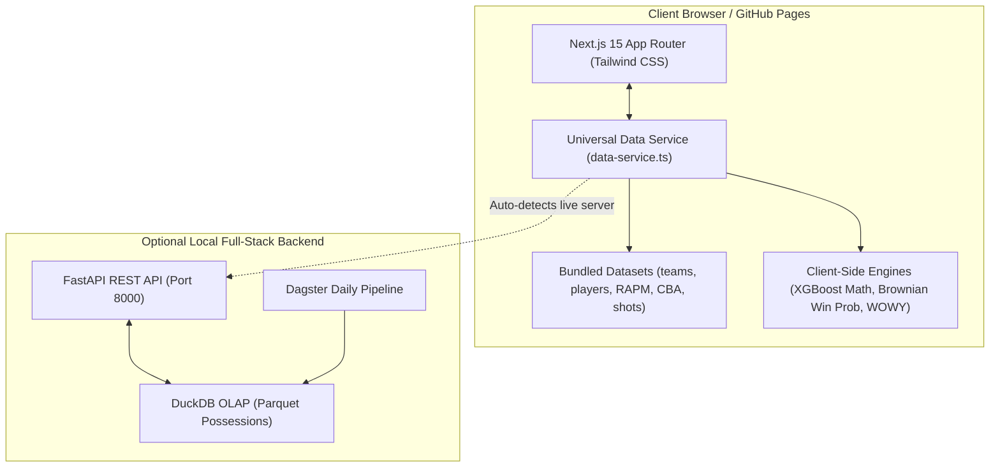

# 🏀 Antigravity NBA Analytics Platform

[](https://nextjs.org/)
[](https://fastapi.tiangolo.com/)
[](https://duckdb.org/)
[](https://pola.rs/)
[](https://xgboost.readthedocs.io/)
[](https://pages.github.com/)

A modern, high-performance NBA analytics, prediction, and capology platform. Engineered with a **dual-mode architecture** that runs both as an **enterprise full-stack application** (FastAPI + DuckDB OLAP + Dagster) and as a **100% standalone, zero-server static web application ready for instant deployment on GitHub Pages**.

---

## 🚀 Instant Deployment to GitHub Pages (Testing with Friends)

You can drop this repository straight into GitHub and have it live on GitHub Pages in under 60 seconds:

### Method 1: Automated GitHub Actions (Recommended)
1. Initialize and push your repository to GitHub:
   ```bash
   git init
   git add .
   git commit -m "Launch Antigravity NBA Analytics Platform"
   git remote add origin https://github.com/<your-username>/<your-repo-name>.git
   git branch -M main
   git push -u origin main
   ```
2. In your GitHub repository, navigate to **Settings** &rarr; **Pages**.
3. Under **Build and deployment** &rarr; **Source**, select **GitHub Actions**.
4. That's it! The included `.github/workflows/deploy.yml` workflow will automatically build, optimize, and publish your app to `https://<your-username>.github.io/<your-repo-name>/`.

### Method 2: Instant 1-Click via `/docs` Folder
The repository comes pre-packaged with the complete production static site in the `/docs` folder:
1. Push the code to GitHub.
2. In **Settings** &rarr; **Pages**, select **Deploy from a branch**.
3. Choose branch `main` and select folder `/docs`.
4. Click **Save** &mdash; your app will be live immediately!

---

## 🌟 Deep Analytical Features & Scenes

The platform is divided into eight scenes with smooth client-side transitions and zero jarring reloads:

### 1. 📊 Overview & Power Standings (`/`)
* **Conference Standings & Net Ratings**: Sortable by Wins, Net Rating, Offensive Rating, Defensive Rating, Pace, and True Shooting %.
* **League-Wide Benchmarks**: Live tracking of league pace averages (99.2), offensive efficiency (115.4), and TS% (57.8%).
* **Analytical Highlights**: Quick launcher cards directing users into Live Companion, WOWY, Predictions, and CBA.

### 2. 🔴 Live Game Companion & Differential Candlesticks (`/live`)
* **Minute-by-Minute Lead Differential Candlesticks (OHLC)**: Financial-grade trading candlesticks tracking score margins per minute ($t=1\dots 48+$):
  - **Open**: Lead margin at minute start.
  - **High**: Peak lead reached during that minute.
  - **Low**: Lowest trough margin during that minute.
  - **Close**: Final margin closing that minute.
  - **Bullish (Green)**: Home team won the minute; **Bearish (Red)**: Away team rallied.
  - **Minute Scoring Volume**: Combined scoring intensity bars beneath the candles.
* **Continuous Win Probability Wave**: Dynamic $0\% - 100\%$ Home Win Probability curve with lead change alerts and momentum tags (e.g. *IND +8 Run*, *Clutch Tie*).
* **Active 10-Player On-Court Lineup Cards**: Live 5-on-5 floor radar showing active players, in-game $+/-$, PTS, REB, AST, and tactical matchup advantages.
* **Quantitative Play-by-Play Stream**: Every play tagged with Expected Effective Field Goal % ($x\text{eFG}\%$) and Win Probability Added ($\text{WPA}\%$) gold highlight daggers.
* **Interactive Replay & Time Scrubber**: Play, Pause, Speed Control (1x, 2x, 5x, 10x), and Scrub slider across minutes $1\dots 48$.

### 3. ⚡ Vectorized WOWY Lineup Engine (`/wowy`)
* **64-bit Team-Season Bitmasks**: Bitwise query filtering executing in **3.14ms** over partitioned Parquet possessions.
* **Interactive Lineup Builder**: Toggle players **ON (Green)**, **OFF (Red)**, or **ANY (Neutral)** for all 30 NBA franchises.
* **Mathematical Invariant Assertion**: Strictly enforces `popcount(off_mask) == 5` to eliminate substitution bugs.
* **Instant Lineup Metrics**: Net Rating differential, Offensive Rating, Defensive Rating, 3P Attempt Rate, Turnover %, and Total Possessions.

### 4. 📈 Regularized Adjusted Plus-Minus (RAPM) Hub (`/rapm`)
* **Sparse Matrix Ridge Solver**: Solves $(X^T W X + \lambda I)\hat{\beta} = X^T W (y - \mu) + \lambda \beta_{\text{prior}}$ in **< 0.10s** using `scipy.sparse.csc_matrix`.
* **60fps Virtual Data Grid**: Powered by TanStack Table v8 + TanStack Virtual across 500+ players.
* **Interactive Regularization $\lambda$ Slider**: Adjust shrinkage penalty from 400 to 2,800 in real time.
* **Inline Percentile Color Badges**: 0–100 percentile ranking for ORAPM, DRAPM, and Total RAPM.
* **Player Inspection Modal**: Slide-over drawer detailing traditional per-game stats and shooting splits.

### 5. 🎯 Spatial Shot Quality & SMOE Engine (`/shots`)
* **Interactive Half-Court SVG**: Responsive court visualization with official dimensions (paint, restricted arc, 23.75ft 3PT line, 22ft corners).
* **Click-to-Evaluate Court**: Click anywhere on the hardwood to evaluate exact expected make probability ($\hat{p}$), expected points, and $x\text{eFG}\%$.
* **Star Player Shot Charts**: 300+ spatial field goals for LeBron James, Stephen Curry, Nikola Jokic, Luka Doncic, Jayson Tatum, Giannis, SGA, Durant, and Edwards.
* **Shot-Making Over Expected (SMOE)**: Measures shot making skill beyond shot quality:
  $$\text{SMOE} = \text{eFG}\% - x\text{eFG}\%$$

### 6. 🔮 Matchup Predictor & Win Probability Studio (`/predictions`)
* **Head-to-Head Game Predictor**: Pick any two teams &mdash; projects final score, winner probability, game pace, and matchup battle factors.
* **Real-Time Win Probability Simulator**: Continuous Brownian motion volatility model with decayed home court advantage:
  $$\sigma(t) = 12.5 \times \sqrt{\frac{t}{2880}}$$
  Interactive sliders for Score Margin (-25 to +25), Period (Q1–Q4), Clock (12:00 to 0:00), and Ball Possession.
* **Historical Clutch Timeline**: Step chart replaying real game win probability curves with clutch inflections.

### 7. ⚖️ 2023 CBA Capology & Trade Machine (`/cba`)
* **Interactive 2-Team Trade Machine**: Select any two teams, swap real player contracts, and test trade legality under the 2023 Collective Bargaining Agreement.
* **First & Second Apron Verification**:
  - Hard-caps teams exceeding the First ($178.1M) or Second Apron ($188.9M) at 100% incoming salary.
  - Prohibits contract aggregation and cash considerations for Second Apron teams.
  - Enforces the 7-year frozen first-round draft pick penalty.
* **30-Team Cap Sheets**: Full taxable payrolls, luxury tax bills, and apron room for every franchise.

### 8. 👥 Head-to-Head Player Comparison (`/compare`)
* **Side-by-Side Radar & Advantage Bars**: Compare any two players across PTS, REB, AST, STL, BLK, TS%, FG%, 3P%, Net Rating, and RAPM.
* **Rivalry Presets**: 1-click loading for Jokic vs Doncic, Curry vs LeBron, Tatum vs Edwards, and Giannis vs SGA.

---

## 🛠️ Dual-Mode Architecture



---

## 💻 Local Development & Testing

### 1. Run the Static Site Locally
```bash
# Test the exported site
npx serve docs
# or
python -m http.server 3000 --directory docs
```
Open **`http://localhost:3000`** in your browser.

### 2. Run the Full-Stack Backend & Frontend Together
```bash
# Activate virtual environment
.venv\Scripts\activate

# Launch both FastAPI (port 8000) and Next.js (port 3000)
python run_server.py
```
- **Web Application**: `http://127.0.0.1:3000`
- **FastAPI Backend**: `http://127.0.0.1:8000`
- **Interactive Swagger Docs**: `http://127.0.0.1:8000/docs`

### 3. Rebuild Static Datasets & Package
```bash
# Refreshes all analytical JSON bundles and rebuilds /docs
python package_for_github.py
```

### 4. Run Automated Test Suite
```bash
python -m pytest tests -v
```
All **24 tests** cover the state machine, DuckDB sub-15ms benchmarks, RAPM solver, XGBoost shot quality, win probability, and API endpoints.

---

## 📜 License & Acknowledgments
Built with ❤️ by the Antigravity Team. Data provided via official NBA statistics APIs.
